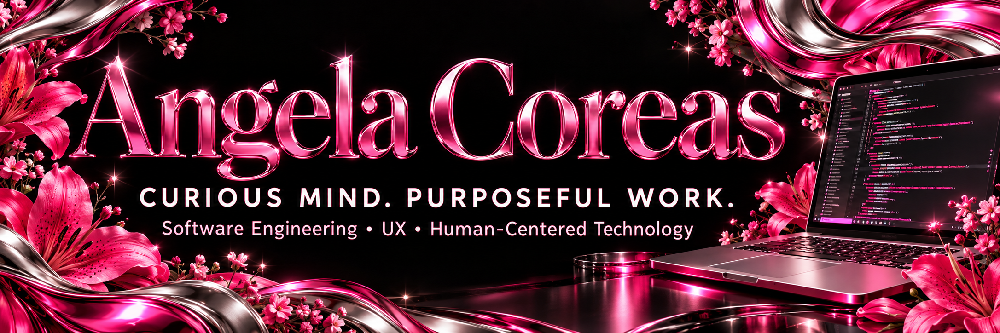

  

<h1 align="center">✦ Angela Coreas | Professional Portfolio ✦</h1>

  Customer Experience • Operations & Systems Support • Software Engineering Student

  <a href="https://angelacoreas1989-boop.github.io/tech-portfolio/">View Portfolio</a> •
  <a href="https://www.linkedin.com/in/angela-coreas-550088186/">LinkedIn</a> •
  <a href="mailto:ostorga.angelac@gmail.com">Email Me</a>

---

## About Me

I’m Angela Ostorga Coreas, a Software Engineering student at Western Governors University with more than 10 years of experience in customer service, multifamily operations, centralized leasing, and systems support.

I love to learn about everything. I learn quickly, ask questions, and give my all to whatever I do—from understanding a new system to helping someone work through a difficult situation.

Working with people is one of my strengths. I connect with different personalities and adapt my communication so people feel heard, respected, and supported. I listen to understand, not simply to respond, and believe thoughtful service includes following through.

My portfolio brings together that professional experience and my growing technical skills through customer-focused applications, small-business websites, and personalized learning tools.

## What I Bring

- More than 10 years of customer-facing and operational experience
- Bilingual communication in English and Spanish
- High-volume customer support and prospect management
- Application processing, documentation, and data accuracy
- Escalation management and cross-team coordination
- Workflow investigation and systems troubleshooting
- Experience reviewing AI-assisted customer interactions
- Adaptability, accountability, and consistent follow-through
- A growing foundation in software engineering and user experience

## Featured Projects

### Portuguese Study Studio

A personalized Brazilian Portuguese learning website with **1,833 study cards** across **71 guidebooks**:

- 936 vocabulary cards
- 590 sentence cards
- 307 grammar cards

Features include interactive flashcards, search, section and guidebook filters, pronunciation audio, adjustable speaking speed, confidence ratings, priority review, progress tracking, and backup/restore.

I curated the learning content and used AI-assisted development to turn my study needs into a working website. I guided improvements through repeated use and feedback, including mobile readability, card visibility, navigation, and audio quality.

**Technologies:** HTML, CSS, JavaScript, Speech Synthesis, localStorage

[Open Portuguese Study Studio](https://angela-portuguese-flashcards.angelacoreas1989.chatgpt.site/)

### Italian Study Studio

A separate Italian learning website with **625 study cards**:

- 300 vocabulary cards
- 217 sentence cards
- 108 grammar cards

The studio includes pronunciation support, filtering, search, confidence ratings, progress tracking, priority review, and backup/restore.

Created with AI-assisted development, the project reflects my interest in language learning, personalized design, and improving an experience through hands-on feedback. Italian and Portuguese study progress remain independent.

**Technologies:** HTML, CSS, JavaScript, Speech Synthesis, localStorage

[Open Italian Study Studio](https://angela-italian-flashcards.angelacoreas1989.chatgpt.site/)

### Interactive World Map

An Angular and TypeScript application that displays geographic and economic country information retrieved from the World Bank API.

The project demonstrates API integration, Angular services, event handling, interactive SVG elements, and dynamic data presentation.

**Technologies:** Angular, TypeScript, HTML, CSS, SVG, REST API

[View Project Showcase](https://github.com/angelacoreas1989-boop/interactive-world-map-showcase)

### Discovering Georgia Tourism Website

A responsive, multi-page tourism website created for WGU’s Front-End Web Development course.

Received a **WGU Excellence Award**. Evaluation faculty praised my wireframes and page layouts for being clean, readable, and clearly organized.

**Technologies:** HTML, CSS, Responsive Web Design

[View Project Showcase](https://github.com/angelacoreas1989-boop/georgia-tourism-website-showcase)

### Magnolia Grove Rental Experience

A multi-page apartment-search and rental-application experience connecting availability, screening requirements, policies, and application steps.

Inspired by my professional experience helping customers navigate leasing processes.

**Technologies:** HTML, CSS, JavaScript

[Live Demo](https://angelacoreas1989-boop.github.io/apartment-application-portal/) •
[Repository](https://github.com/angelacoreas1989-boop/apartment-application-portal)

### Leasing Application Portal

An interactive leasing operations dashboard that simulates applicant search, application review, status filtering, and leasing decisions.

The project translates familiar operational workflows into an organized front-end application.

**Technologies:** HTML, CSS, JavaScript

[Live Demo](https://angelacoreas1989-boop.github.io/leasing-application-portal/) •
[Repository](https://github.com/angelacoreas1989-boop/leasing-application-portal)

### Small-Business Websites

Responsive websites focused on presenting services clearly and helping customers take the next step.

- [Nicole’s Flower Designs](https://angelacoreas1989-boop.github.io/nicole-flower-designs/)
- [Prime Nails by Fernanda](https://angelacoreas1989-boop.github.io/prime-nails-by-fernanda/)

## Professional Experience

### Vivmark Residential / Equity Residential

**Centralized Leasing Specialist — Application Processing & Systems Support**  
February 2025–Present

- Support centralized application, leasing, communication, and systems workflows across 100+ communities.
- Investigate workflow and system issues across MRI Software, EliseAI, Anyone Home, and connected processes.
- Manage escalations through issue clarification, impact assessment, documentation, status tracking, and continued communication.
- Review AI-assisted customer interactions for accuracy, context, repetition, usefulness, and unresolved needs.
- Handle 200+ inbound contacts weekly and maintain 150+ active prospects.
- Consistently achieve 95–100% quality scores and 97%+ schedule adherence.

### RPM Living

**Portfolio Leasing Associate — Centralized Operations**  
March 2024–May 2025

- Supported 16 communities within a centralized leasing model.
- Balanced customer communication, application follow-up, CRM documentation, and onsite coordination.
- Worked with Funnel Leasing and provided operational feedback on follow-up and task-creation workflows.
- Identified process gaps and communication breakdowns and offered practical feedback to improve handoffs and customer experience.

### Cortland

**Bilingual Leasing Hub Associate**  
February 2023–September 2023

- Supported 13 communities while maintaining approximately 98% call quality and 100% guest-card calibration.
- Achieved a 65% tour rate against a 60% goal.
- Took initiative to identify recurring communication and workflow problems and propose improvements.
- Selected to travel to Florida to help address and mediate issues between onsite teams and centralized operations.
- Received Employee of the Month and Rising Star / Rising Superstar recognition.

### MAA

**Leasing, Renewals & Resident Operations**  
February 2019–February 2023

- Managed lease renewals from resident outreach through execution.
- Negotiated renewal pricing using approved recommendations while balancing retention and operational goals.
- Managed renters-insurance compliance, including missing coverage, policy questions, and charge issues.
- Used Yardi Voyager renewal and insurance reports to prioritize follow-up and maintain accurate records.
- Supported applications, move-ins, resident account questions, lease changes, and daily property operations.

## Education

**Bachelor of Science in Software Engineering**  
Western Governors University — In progress

**Associate Degree — Criminal Justice / Criminology**  
Completed 2013

## Recognition

- **WGU Excellence Award:** Front-End Web Development; recognized for clean, readable wireframes and organized page layouts.
- **Cortland:** Employee of the Month and Rising Star / Rising Superstar honors.

## Technical Skills & Platforms

**Development:**  
HTML, CSS, JavaScript, Angular, TypeScript, REST APIs, Git, GitHub, and Python fundamentals

**Design & Usability:**  
Responsive layouts, user flows, information hierarchy, form organization, and iterative interface improvements

**Enterprise & PropTech:**  
MRI Software, Yardi Voyager, Entrata, EliseAI, Funnel Leasing, Anyone Home, Knock CRM, and NICE CXone

**Continuing to Learn:**  
Figma, interaction design, accessibility, human-AI interaction, and data management

## Languages

- English — Fluent
- Spanish — Native / Bilingual
- Italian — Elementary
- Portuguese — Elementary

## Open to Opportunities

I’m interested in customer service, customer experience, centralized operations, application processing, and systems or application support roles where I can contribute my experience working with people and solving problems.

I’m also exploring technical support, enterprise software, PropTech, UX, product support, and front-end development opportunities, including Summer 2027 internships.

I bring a willingness to learn, care for the people I support, and a commitment to doing the work well.

## About This Repository

This repository contains the source for my professional portfolio, published through GitHub Pages.

The website uses HTML, CSS, and JavaScript and includes responsive layouts, project links, professional experience, education, and contact information.

## Contact

**School email:** [acorea3@wgu.edu](mailto:acorea3@wgu.edu)  
**Personal email:** [ostorga.angelac@gmail.com](mailto:ostorga.angelac@gmail.com)

[LinkedIn](https://www.linkedin.com/in/angela-coreas-550088186/) •
[GitHub](https://github.com/angelacoreas1989-boop) •
[Portfolio](https://angelacoreas1989-boop.github.io/tech-portfolio/)

**Professional references available upon request.**

---

  ✦ Always Curious • Dedicated to Learning • Building with Purpose ✦

